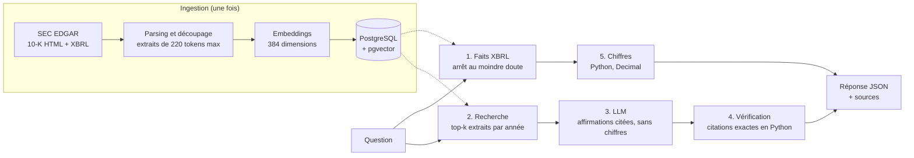

# FinSight

**Des réponses sur les rapports annuels d'Apple (10-K, SEC), où chaque affirmation est prouvée.**

FinSight répond à des questions sur les rapports 10-K d'Apple (exercices 2023, 2024 et 2025)
avec une règle centrale : **aucune affirmation sans preuve vérifiable**.

- **Les chiffres ne sont jamais écrits par le LLM.** Ils viennent des données XBRL officielles
  de la SEC et sont calculés en Python, en arithmétique décimale exacte.
- **Le texte est vérifié mot pour mot.** Le LLM rédige des affirmations à partir d'extraits
  retrouvés par recherche vectorielle ; chacune n'est gardée que si une **citation exacte** de
  l'extrait la confirme. Ce contrôle est fait en Python, pas par le modèle.
- **Tout est mesuré.** Deux bancs d'évaluation (recherche et vérificateur) servent à comparer les
  approches avant de les adopter.

## Exemple

Question : *« What are Apple's main supply chain risks? »* (exercice 2025)

```jsonc
{
  "numeric_claims": [{
    // Écrit par le code, à partir des faits XBRL F2025_REVENUE, F2025_NET_INCOME…
    "text": "FY2025: revenue 416.161 billion USD; net income 112.010 billion USD; net margin 26.92%; operating margin 31.97%."
  }],
  "document_claims": [{
    // Écrit par le LLM, gardé car la citation existe mot pour mot dans l'extrait cité
    "text": "The Company is subject to significant supply and pricing risks due to its reliance on single or limited sources for certain components.",
    "source_ids": ["D2025_apple-2025-00067"],
    "quotes": [{
      "source_id": "D2025_apple-2025-00067",
      "quote": "Because the Company currently obtains certain components from single or limited sources, the Company is subject to significant supply and pricing risks."
    }]
  }],
  "stats": { "generated": 6, "rejected_numeric": 0, "rejected_unverified": 4 }
}
```

Sur les 6 affirmations proposées par le LLM, 4 ont été rejetées faute de preuve exacte : le
système préfère répondre moins que répondre faux. Chaque source renvoie au document officiel de
la SEC.

## Architecture



| Étape | Fichier | Rôle |
|---|---|---|
| Faits | [`facts.py`](src/finsight/facts.py) | Lit les faits XBRL ; s'arrête si une unité, une provenance ou une valeur est douteuse. |
| Recherche | [`retrieval.py`](src/finsight/retrieval.py) | Similarité cosinus dans pgvector, `top_k` extraits **pour chaque année** demandée. |
| Génération | [`generation.py`](src/finsight/generation.py) | Le LLM rédige des affirmations citées ; tout nombre est filtré. |
| Vérification | [`verification.py`](src/finsight/verification.py) | Découpe chaque affirmation en propositions et vérifie chaque citation mot pour mot. |
| Chiffres | [`metrics.py`](src/finsight/metrics.py) | Marges et croissance en `Decimal`, avec la trace des faits utilisés. |
| LLM | [`llm.py`](src/finsight/llm.py), [`bedrock.py`](src/finsight/bedrock.py) | Interface commune : Ollama en local, Claude sur Amazon Bedrock, Azure OpenAI. |
| API | [`api.py`](src/finsight/api.py) | FastAPI : `/api/ask`, `/api/health`, page de démo, limite de débit, cache. |

## Résultats

**Recherche** : 86 questions dont la réponse est dans les 10-K (71 en anglais, 15 en français),
avec pour chacune la phrase exacte du rapport qui contient la réponse. Hit@2 = part des
questions dont le bon passage est dans les 2 premiers résultats (la production en garde 2 par
année).

| Approche | Hit@2 | Hit@2 français | Latence / question |
|---|---|---|---|
| MiniLM (production actuelle) | 0,70 | 0,27 | 15 ms |
| Recherche hybride (BM25 + MiniLM) | 0,80 | 0,33 | 18 ms |
| **Modèle multilingue e5-small** | **0,80** | **0,53** | 27 ms |
| e5-small + petit reranker | 0,97 | 0,93 | 3,7 s |
| e5-small + gros reranker | 0,99 | 1,00 | 31 s |

**Vérificateur** : 64 affirmations, dont 34 pièges (mauvaise entité, négation, cause inventée,
risque présenté comme un fait, injection de prompt…). Avec un petit modèle local (qwen2.5:3b) :
**2 pièges acceptés sur 34**, précision de 0,91.

Le détail, l'analyse et le raisonnement derrière chaque choix sont dans
[`docs/DECISIONS.md`](docs/DECISIONS.md).

## Démarrer avec Docker

Prérequis : Docker, et [Ollama](https://ollama.com) sur la machine avec le modèle
`qwen2.5:3b` (`ollama pull qwen2.5:3b`), ou un accès à Amazon Bedrock.

```bash
cp .env.example .env              # puis renseigner SEC_USER_AGENT (nom + e-mail, exigé par la SEC)

docker compose up -d db           # PostgreSQL + pgvector ; le schéma est créé au premier démarrage
docker compose run --rm ingest    # télécharge les 10-K et les données XBRL, puis remplit la base
docker compose up -d --build api  # API et page de démo sur http://127.0.0.1:8000
```

```bash
curl -X POST http://127.0.0.1:8000/api/ask \
     -H "Content-Type: application/json" \
     -d '{"question": "What are Apple'\''s main supply chain risks?", "years": [2025]}'
```

Pour utiliser Claude sur Amazon Bedrock au lieu d'Ollama, renseigner dans `.env` :
`LLM_PROVIDER=bedrock`, `AWS_REGION` et `AWS_BEARER_TOKEN_BEDROCK` (voir
[`.env.example`](.env.example)).

## Développement

```bash
pip install -e ".[dev,ingest]"
pytest                                        # 164 tests, sans réseau ni base (faux LLM)
ruff check . && ruff format --check .
finsight "What are Apple's main supply chain risks?" --years 2024 2025 -v
finsight-eval retrieval --name dense-e5-small  # banc de recherche (sans base ni Docker)
finsight-eval verifier --limit 3               # banc du vérificateur (LLM requis)
```

```
src/finsight/   l'application (pipeline, API, CLI, évaluation)
scripts/        ingestion : téléchargement SEC, parsing, découpage, embeddings, insertion
sql/            schéma PostgreSQL, appliqué dans l'ordre
eval/           jeux d'évaluation et résultats sauvegardés
tests/          tests pytest
docs/           journal des décisions et résultats détaillés
```

## Stack

Python 3.11+ · PostgreSQL 16 + pgvector · sentence-transformers · FastAPI · pydantic ·
Ollama · Amazon Bedrock (SDK Anthropic) · Docker Compose · pytest · ruff

## Limites et suite

- **Le LLM local est lent** : environ 20 minutes par question avec qwen2.5:3b sur CPU. Le client
  Claude sur Amazon Bedrock est intégré et testé unitairement ; son évaluation sur le banc du
  vérificateur est la prochaine étape.
- **Passer la production sur le modèle multilingue e5-small**, puis choisir entre le petit
  reranker et plus d'extraits par année grâce à une évaluation de bout en bout.
- **Déploiement sur AWS** et intégration continue (GitHub Actions).
- **Une seule entreprise** pour l'instant : la méthode s'applique à tout document où une preuve
  est exigée.

Les données viennent de [SEC EDGAR](https://www.sec.gov/edgar), base publique de la SEC.
FinSight ne donne pas de conseil en investissement : les demandes de conseil sont signalées.
